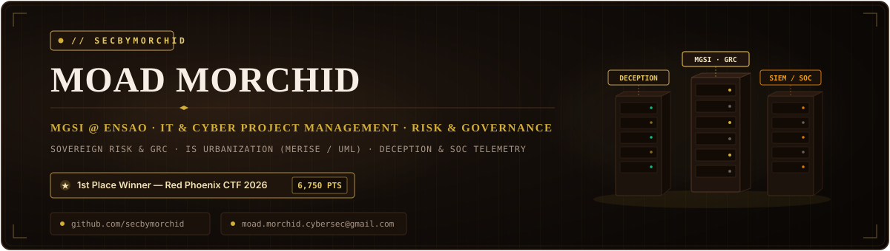
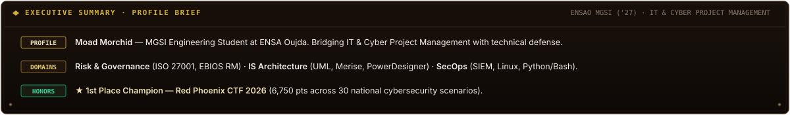
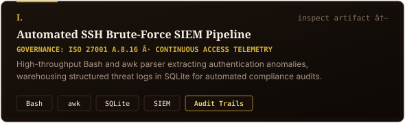
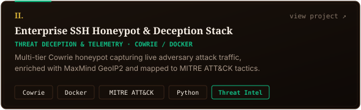
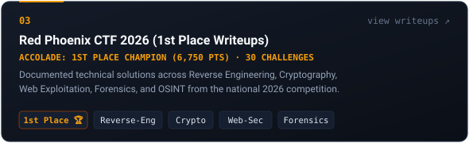
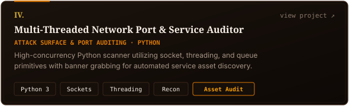
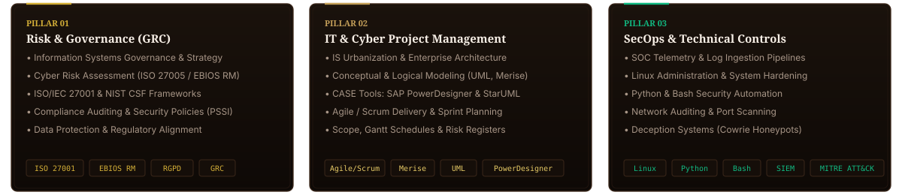
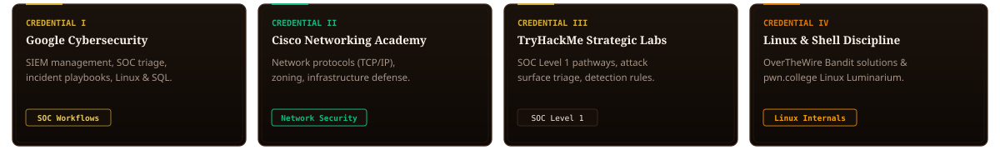
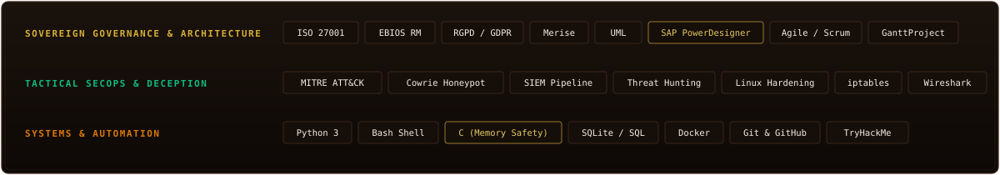

  <!-- Executive Savile Row Banner -->
  

  <!-- Executive Profile Summary -->
  

    

  <!-- Section 01: Featured Projects & Technical Controls -->
  
  

    
    
  

  

    
    
  

   

  <!-- Section 02: Core Competencies & Domains -->
  
  

    

  <!-- Section 03: Certifications & Labs -->
  
  

    

  <!-- Section 04: Technical & Governance Arsenal -->
  
  

    

  <!-- Section 05: Contact & Connect -->
  
  

    
    &nbsp;&nbsp;
    
    &nbsp;&nbsp;
    
  

  <!-- Availability Status Bar -->
  

    

  <!-- Aristocratic Sign-off Quote -->
  

    <code>"SECURITY IS NOT MERELY SYNTAX; IT IS DISCRETION, ARCHITECTURE, AND THE ART OF GOVERNANCE."</code> 
    <small>// SECBYMORCHID</small>
  

