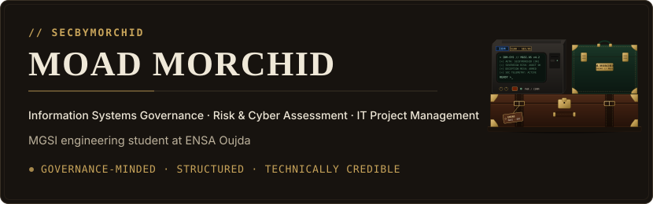
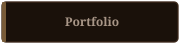
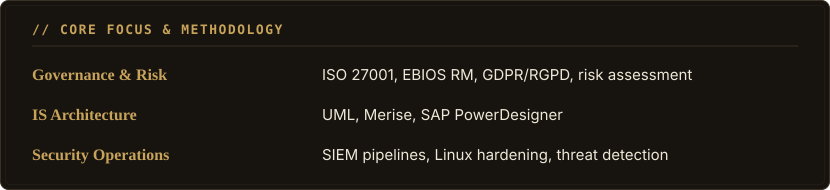
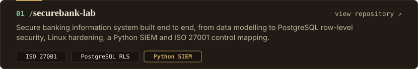
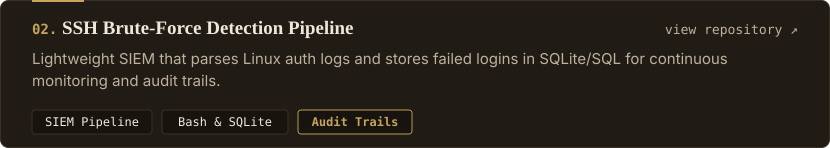
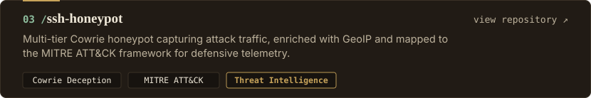
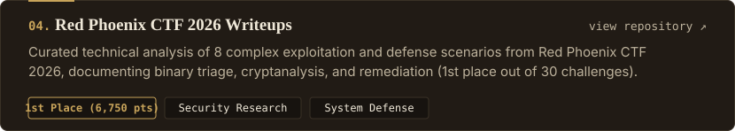
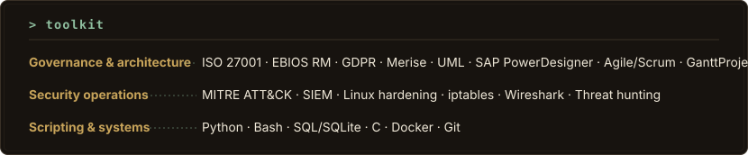
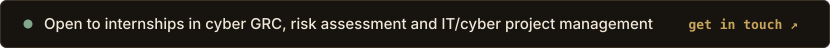

  <!-- 1. HERO -->
  

  <!-- Quick Action & Contact Buttons -->
  

    
    &nbsp;&nbsp;
    
    &nbsp;&nbsp;
    
  

   

  <!-- 2. FOCUS -->
  

    

  <!-- 3. SELECTED WORK -->
  

   

  

   

  

   

  

    

  <!-- 4. TOOLKIT -->
  

    

  <!-- 5. AVAILABILITY -->
  

